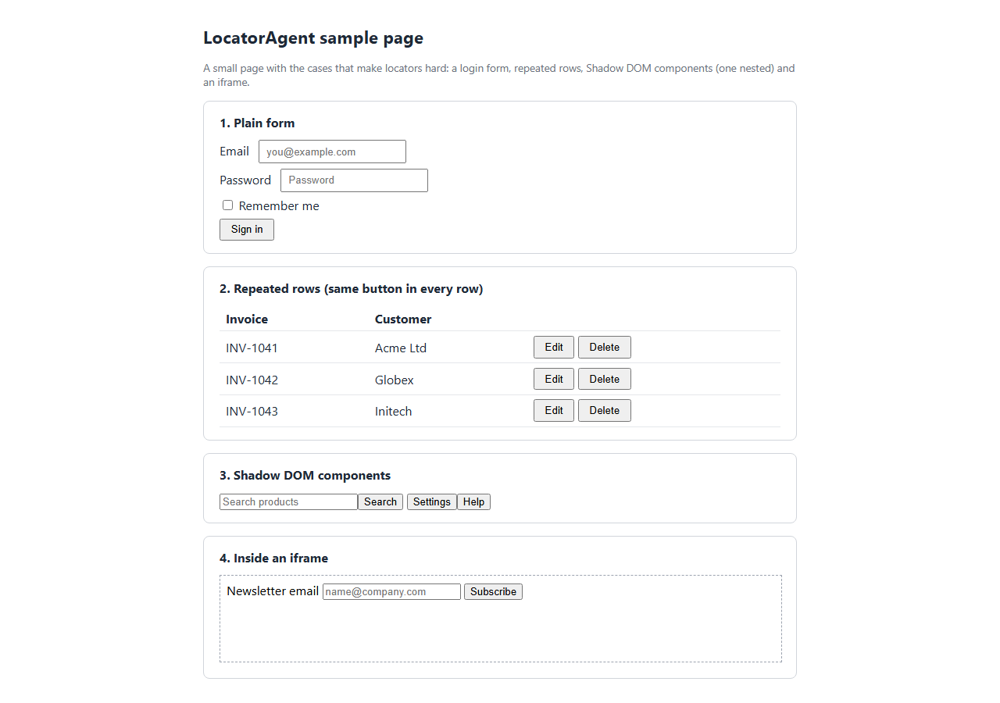
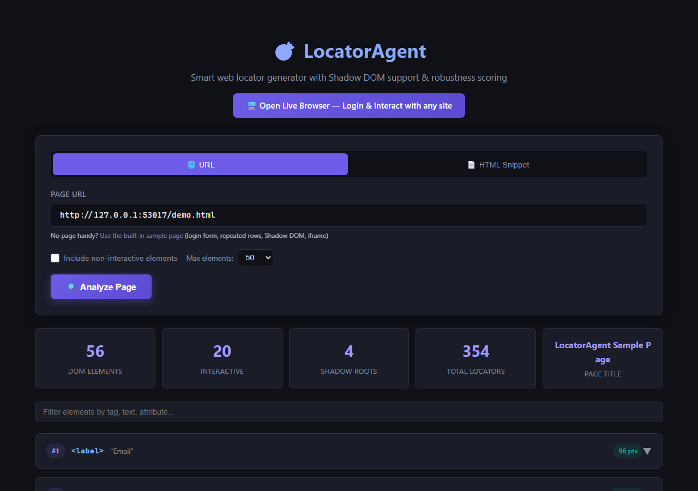
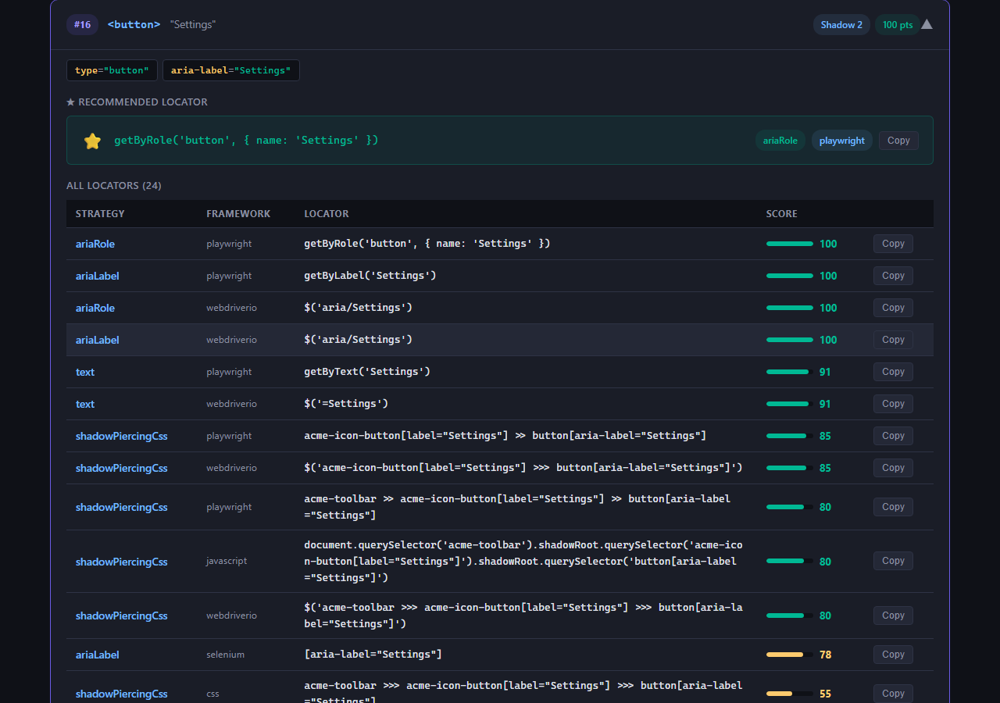
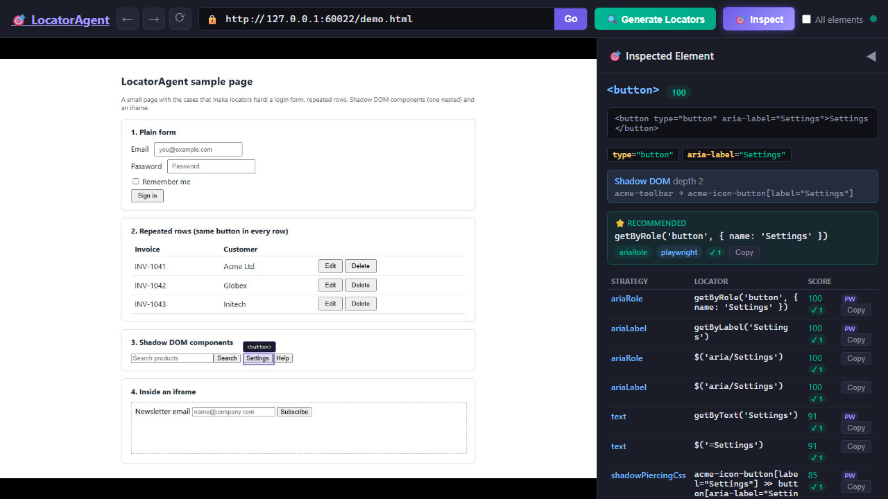
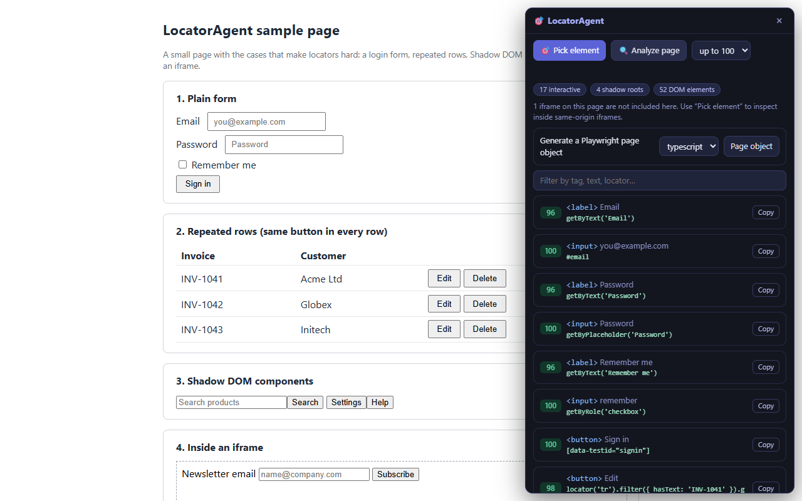
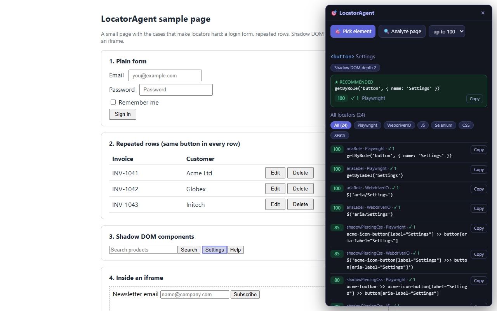

# LocatorAgent User Manual

Version 1.0

LocatorAgent finds the buttons, fields and links on a web page and writes reliable **locators** for them, so test engineers do not have to hunt through the page by hand. This manual explains what it does, how to set it up, and how to use each part of it, step by step.

## Contents

- [1. What LocatorAgent is](#1-what-locatoragent-is)
- [2. Choose how to use it](#2-choose-how-to-use-it)
- [3. Install and set up](#3-install-and-set-up)
- [4. Quick start: your first analysis](#4-quick-start-your-first-analysis)
- [5. The web analyzer](#5-the-web-analyzer)
- [6. The embedded browser](#6-the-embedded-browser)
- [7. Native browser mode](#7-native-browser-mode)
- [8. The browser extension](#8-the-browser-extension)
- [9. The command line](#9-the-command-line)
- [10. Page objects](#10-page-objects)
- [11. The REST API](#11-the-rest-api)
- [12. Docker](#12-docker)
- [13. Using it as a library](#13-using-it-as-a-library)
- [14. How it works](#14-how-it-works)
- [15. Reading the results](#15-reading-the-results)
- [16. Troubleshooting](#16-troubleshooting)
- [17. Limitations](#17-limitations)
- [18. Reference](#18-reference)

## 1. What LocatorAgent is

### The problem

Automated browser tests need a way to say *which* button or field to use. That "address" is called a **locator**, for example `getByRole('button', { name: 'Settings' })`. Writing good locators by hand is slow, and they break when the page changes. Modern pages make it harder: many hide elements inside **Shadow DOM** or **iframes**, where ordinary CSS and XPath selectors cannot reach, and repeated elements (a "Delete" button in every table row) match several things at once.

### What it does

LocatorAgent opens a page in a real browser and then:

1. finds every interactive element, including those inside Shadow DOM and iframes;
2. generates up to 10 kinds of locator for each one;
3. checks each locator against the live page, to confirm it matches **exactly one** element and that it is the **right** one;
4. scores each locator from 0 to 100 and recommends the most stable one;
5. for repeated elements, builds locators scoped to a distinguishing parent, such as the table row;
6. can turn the whole page into a ready-to-use Playwright **page object** in TypeScript, Python or Java.

### Who it is for

Test automation engineers and developers who write Playwright, Selenium, WebdriverIO, CSS or XPath locators, and teams who want a CI check that fails when locators become fragile.

### The sample page

LocatorAgent ships with a sample page that contains the hard cases: a login form, repeated table rows, Shadow DOM components (one nested two levels deep) and an iframe. It is served at `/demo.html` and is used throughout this manual.



## 2. Choose how to use it

| If you want to… | Use | Needs a server? |
|---|---|---|
| Get locators for the page you are looking at, in your own browser | [Browser extension](#8-the-browser-extension) | No |
| Paste a URL or HTML and see locators | [Web analyzer](#5-the-web-analyzer) | Yes (local) |
| Log in or click around first, then pick elements | [Embedded browser](#6-the-embedded-browser) | Yes (local) |
| Use your own Chrome session (SSO, VPN, saved logins) | [Native browser mode](#7-native-browser-mode) | Yes (local) |
| Script it, or fail a CI build on weak locators | [Command line](#9-the-command-line) | No |
| Call it from other tools | [REST API](#11-the-rest-api) | Yes |
| Run it without installing Node | [Docker](#12-docker) | Container |
| Use it inside your own code | [Library](#13-using-it-as-a-library) | No |

## 3. Install and set up

### Requirements

- **Node.js 18 or newer**, with npm.
- **Chromium for Playwright** (one-time download, see below).
- For the browser extension: **Chrome or Edge**.
- For native browser mode: **Chrome or Edge** started with a debugging port.
- For Docker: Docker Desktop or Docker Engine.

### Install from source

1. Get the project folder (clone the repository, or unzip it).
2. Open a terminal in the project folder.
3. Install the dependencies:

   ```bash
   npm install
   ```

4. Download the browser that Playwright uses (npm does not do this for you):

   ```bash
   npx playwright install chromium
   ```

5. Start the server:

   ```bash
   npm run start:api
   ```

6. Open **http://localhost:3000** in your browser.

When the server starts it prints its address and a line describing its safety settings, for example `File access: disabled (set LA_ROOT) | private networks: allowed | token: off`. This is normal. See [The REST API](#11-the-rest-api) to change these.

### Check that it works

```bash
curl http://127.0.0.1:3000/health
```

You should see `{"status":"ok","version":"1.0.0"}`.

## 4. Quick start: your first analysis

This takes about two minutes and needs only the server from section 3.

1. Open **http://localhost:3000**.
2. Under the URL box, click **Use the built-in sample page**. The box fills in `http://localhost:3000/demo.html`.
3. Click **Analyze Page**. Wait a few seconds.
4. Look at the summary cards: DOM elements, interactive elements, **Shadow roots** and total locators.
5. In the filter box, type `Settings` and open the result. This button sits inside two nested Shadow DOM roots, and it still gets a clean locator: `getByRole('button', { name: 'Settings' })`.
6. Filter for `Delete` and open the first result. Three identical buttons exist, so the recommended locator is scoped to the row: `locator('tr').filter({ hasText: 'INV-1041' }).getByRole('button', { name: 'Delete' })`.
7. Click **Copy** next to any locator to put it on your clipboard.



## 5. The web analyzer

The analyzer is the simplest way to use LocatorAgent: give it a page, get locators for every interactive element.

### Analyze a URL

1. Open **http://localhost:3000**.
2. Stay on the **URL** tab and type or paste the page address (it must start with `http://` or `https://`).
3. Choose your options:
   - **Include non-interactive elements**: also analyze things like headings and plain text containers.
   - **Max elements**: 25, 50, 100 or 200. More elements take longer.
4. Click **Analyze Page**.

### Analyze HTML you paste in

1. Click the **HTML Snippet** tab.
2. Paste the HTML source into the box.
3. Click **Analyze Page**.

This is useful for a snapshot saved from a page that needs a login, or for a component you are building.

### Read and use the results

1. The summary cards show how many elements were found and how many Shadow DOM roots were pierced.
2. Use the **filter box** to narrow the list by tag, text or attribute.
3. Click an element to expand it. You see its attributes, its Shadow DOM depth and host chain (if any), the **recommended locator**, and a table of every locator with strategy, framework, score and match count.
4. Click **Copy** to copy a locator.



> **Tip:** the analyzer loads the page in a headless browser on the machine running the server, so it works for any address that machine can reach. For pages behind a login, use the [embedded browser](#6-the-embedded-browser), [native mode](#7-native-browser-mode) or the [extension](#8-the-browser-extension).

## 6. The embedded browser

The embedded browser runs a real Chromium on the server and shows it to you live inside the page. You can click, type and scroll in it, which lets you log in or open a menu **before** getting locators.

### Steps

1. Open **http://localhost:3000/browser.html**.
2. Type a URL in the address bar and press **Enter** or click **Go**. A green dot appears when the session is connected.
3. Use the page as normal: click, type, scroll. The back, forward and reload buttons work.
4. To get locators for one element, click **Inspect**. The pointer changes; hover to highlight elements, and **click** the one you want. Its locators appear in the panel on the right.
5. To get locators for every interactive element, click **Generate Locators**. Tick **All elements** first if you also want non-interactive ones.
6. Click **Copy** next to a locator to copy it.



### Good to know

- A locator with `⚠ 3` next to it matches three elements, so it is not unique on its own. Use the [analyzer](#5-the-web-analyzer) or a [page object](#10-page-objects) to get row-scoped locators for repeated elements.
- Inspect mode does not look inside iframes. Use the [extension](#8-the-browser-extension) for same-origin iframes, or the analyzer, which does analyze iframes.
- The session is created on the server and closed when you leave the page.

## 7. Native browser mode

Native mode attaches to **your own Chrome or Edge**, so you keep your real cookies, extensions and saved logins. It is the best choice for company apps behind single sign-on or a VPN, which a separate headless browser cannot open.

### Steps

1. **Close every Chrome window.** Chrome ignores the debugging flag if another Chrome is already running.
2. Start Chrome with a debugging port.

   Windows (PowerShell):

   ```powershell
   Start-Process "C:\Program Files\Google\Chrome\Application\chrome.exe" `
     -ArgumentList "--remote-debugging-port=9222","--user-data-dir=C:\temp\chrome-debug"
   ```

   macOS:

   ```bash
   /Applications/Google\ Chrome.app/Contents/MacOS/Google\ Chrome \
     --remote-debugging-port=9222 --user-data-dir=/tmp/chrome-debug
   ```

3. Start the LocatorAgent server (`npm run start:api`) and open **http://localhost:3000/native.html**.
4. Click **Connect**. Wait for the connection message.
5. Enter a URL and click **Go**. The page appears inside LocatorAgent, streamed from your Chrome.
6. Log in if needed, then click **Inspect** to pick one element or **Analyze** to scan the whole page.

> **Security note:** the debugging port gives full control of that Chrome to anything on your computer that can reach it. Use a separate profile (the `--user-data-dir` above), and close that Chrome when you are done. Native mode is not covered by the server's network filter.

## 8. The browser extension

The extension gives you locators for the page you are looking at, directly in Chrome or Edge. It needs no server and no Playwright, and it makes no network requests.

### Install it

1. In the project folder, build it:

   ```bash
   npm install
   npm run build:extension
   ```

2. Open `chrome://extensions` (or `edge://extensions`).
3. Switch on **Developer mode** (top right).
4. Click **Load unpacked** and choose the **`extension`** folder inside the project.
5. Optional: click the puzzle-piece icon in the toolbar and **pin** LocatorAgent.

### Use it

1. Open any web page.
2. Click the LocatorAgent toolbar button, or press **Alt+L**. A panel appears at the top right of the page. Click the button again (or the **×**) to hide it.
3. To get locators for one element:
   1. Click **Pick element**.
   2. Hover over the page. Elements are outlined as you move.
   3. Click the one you want. The page does **not** receive your click. Press **Esc** to cancel instead.
   4. Read the **recommended locator**, then browse **All locators**. Use the framework chips (Playwright, Selenium, CSS, XPath and others) to filter, and **Copy** to copy.
4. To analyze the whole page:
   1. Choose how many elements to analyze (50, 100 or 200).
   2. Click **Analyze page**.
   3. Use the filter box to search; click an item to expand its locators and to scroll to and flash the element on the page.
5. To export a page object: after analyzing, choose a language (typescript, python, java) and click **Page object**. Then **Copy** it or **Download** the file.





### Share it with others

```bash
npm run package:extension
```

This writes `extension/locator-agent-extension-1.0.0.zip`. A colleague can unzip it and use **Load unpacked** on the unzipped folder. The same zip can be uploaded to the Chrome Web Store or Edge Add-ons, or deployed to company browsers through enterprise policy.

### Privacy and permissions

- Everything runs inside the page. Nothing is sent anywhere.
- It asks only for `activeTab` and `scripting`. It does nothing on a page until you click its button, and it has no standing access to any website.
- The toolbar shows a red **!** on pages the browser does not allow extensions on (for example `chrome://` pages and the Web Store).

### What it cannot do

- Cross-origin iframes and closed shadow roots cannot be reached.
- **Analyze page** covers the main document. **Pick element** also works inside same-origin iframes.
- Chrome and Edge only (Manifest V3). Firefox is not supported.

## 9. The command line

The command line is for scripts, batch jobs and CI. These examples use `npm run cli --`; if you installed the package, use `npx locator-agent` instead.

### Analyze a page

```bash
# A live URL
npm run cli -- analyze --url https://example.com

# A saved HTML file
npm run cli -- analyze --file ./snapshot.html

# Inline HTML
npm run cli -- analyze --html "<button id='go'>Go</button>"

# Everything, including non-interactive elements, as JSON
npm run cli -- analyze --url https://example.com --all --json

# A logged-in page, using a saved Playwright session
npm run cli -- analyze --url https://app.example.com --storage-state ./auth.json
```

| Option | Meaning | Default |
|---|---|---|
| `-u, --url <url>` | Page address | |
| `-f, --file <path>` | HTML file | |
| `--html <html>` | Raw HTML text | |
| `-a, --all` | Include non-interactive elements | off |
| `-m, --max <number>` | Maximum elements | 50 |
| `-t, --timeout <ms>` | Page load timeout | 30000 |
| `-s, --storage-state <path>` | Reuse a logged-in Playwright session | |
| `-j, --json` | Print the full result as JSON | off |
| `--top <n>` | Locators shown per element | 3 |
| `--fail-below <score>` | CI gate (see below) | off |

Give exactly one of `--url`, `--file` or `--html`.

### Make a CI build fail on weak locators

```bash
npx locator-agent analyze --url https://staging.example.com/login --fail-below 85
```

The command exits with **code 2** when any element's best locator scores below 85, matches several elements, or matches the wrong one. The failing elements are listed on the error stream. In a CI system, treat a non-zero exit as a failed step.

| Exit code | Meaning |
|---|---|
| 0 | Success |
| 1 | Error: bad input, unreachable page, or the browser is missing |
| 2 | The quality gate failed |

### Save a login for reuse

If a page needs a login, save a Playwright session once and pass it with `--storage-state`:

1. Log in using Playwright (for example with `npx playwright codegen --save-storage=auth.json https://app.example.com`).
2. Run LocatorAgent with `--storage-state ./auth.json`.

Keep `auth.json` private. It contains your session cookies.

## 10. Page objects

A **page object** is a class that gives each element on a page a readable name, so tests read `login.signInButton.click()` instead of repeating selectors. LocatorAgent writes one for you, using the best locator that matched each element during analysis.

### Generate one

```bash
# Print a TypeScript page object
npm run cli -- page-object --url https://example.com/login

# Save it with a chosen class name
npm run cli -- page-object --url https://example.com/login -n LoginPage -o pages/LoginPage.ts

# Python or Java
npm run cli -- page-object --url https://example.com/login -l python -o pages/login_page.py
npm run cli -- page-object --url https://example.com/login -l java --package com.acme.pages -o LoginPage.java
```

You can also generate one in the [extension](#8-the-browser-extension) or through the [REST API](#11-the-rest-api).

| Option | Meaning | Default |
|---|---|---|
| `-l, --language` | `typescript`, `python` or `java` | typescript |
| `-n, --class-name` | Class name | from the page title |
| `-o, --out <path>` | Write to a file instead of printing | |
| `--package <name>` | Java package name | |
| `--import-from <module>` | TypeScript: where `Page` and `Locator` come from | `@playwright/test` |
| `--min-score <n>` | Skip elements whose best locator scores below this | 0 |
| `--no-goto` | Do not generate a `goto()` method | |
| `-m, --max <number>` | Maximum elements | 100 |
| `-s, --storage-state` | Reuse a logged-in session | |
| `-j, --json` | Print the full result as JSON | |

### What the output looks like

```ts
export class LoginPage {
  readonly emailInput: Locator;
  readonly signInButton: Locator;
  readonly deleteButtonInv1042: Locator;

  constructor(page: Page) {
    this.page = page;
    this.emailInput = page.locator('#email');
    this.signInButton = page.locator('[data-testid="signin"]');
    this.deleteButtonInv1042 = page.locator('tr').filter({ hasText: 'INV-1042' }).getByRole('button', { name: 'Delete' });
  }
}
```

- Names come from the element's label and kind (`signInButton`, `emailInput`). Repeated elements get the text of their row (`deleteButtonInv1042`).
- Elements inside iframes are reached through `frameLocator(...)`.
- A locator that could not be confirmed unique is marked `// TODO` so you review it.

### Use it in a test

```ts
import { test } from '@playwright/test';
import { LoginPage } from './pages/LoginPage';

test('sign in', async ({ page }) => {
  const login = new LoginPage(page);
  await page.goto('https://example.com/login');
  await login.emailInput.fill('me@example.com');
  await login.signInButton.click();
});
```

## 11. The REST API

Use the API to call LocatorAgent from other programs.

### Start it

```bash
npm run start:api
```

By default it listens on `http://127.0.0.1:3000`.

### Endpoints

| Method and path | Purpose |
|---|---|
| `POST /analyze` | Analyze a page and return all elements with locators |
| `POST /analyze/element` | Same, but only elements matching a `query` (text, id, name, test id, label, placeholder, class or tag) |
| `POST /generate/page-object` | Analyze a page and return a page object |
| `GET /health` | Check that the server is up |
| `GET /sessions` | List active live-browser sessions |

### Example: analyze a URL

```bash
curl -X POST http://127.0.0.1:3000/analyze \
  -H "Content-Type: application/json" \
  -d '{"url":"http://localhost:3000/demo.html","maxElements":100}'
```

### Example: analyze HTML

```bash
curl -X POST http://127.0.0.1:3000/analyze \
  -H "Content-Type: application/json" \
  -d '{"html":"<button data-testid=\"submit\">Go</button>"}'
```

### Request fields

| Field | Meaning |
|---|---|
| `url` | Page address (`http` or `https` only) |
| `html` | Raw HTML text |
| `filePath` | A file on the server, inside `LA_ROOT` (disabled until you set it) |
| `includeNonInteractive` | Include non-interactive elements |
| `maxElements` | Maximum elements (capped at 1000) |
| `timeout` | Page load timeout in ms (capped at 120000) |
| `storageState` | A saved session file inside `LA_ROOT` |
| `className`, `language`, `javaPackage`, `minScore`, `importFrom`, `noGoto` | Page object options, for `/generate/page-object` |

Each analyzed element in the response has its tag, attributes, text, Shadow DOM depth and host chain, every locator with strategy, framework, score and match count, and the recommended locator.

### Configure and secure the server

The server drives a real browser and can read files, so it is locked down by default. With no settings it listens on the local machine only, refuses cross-site browser requests, disables file access, accepts only `http` and `https` URLs, and allows 4 analyses at once. Change it with environment variables set **before** starting the server.

PowerShell:

```powershell
$env:LA_ROOT = "C:\work\snapshots"
$env:LA_API_TOKEN = "choose-a-long-random-value"
npm run start:api
```

macOS or Linux:

```bash
LA_ROOT=/work/snapshots LA_API_TOKEN=choose-a-long-random-value npm run start:api
```

| Variable | Default | Meaning |
|---|---|---|
| `PORT` | 3000 | Port |
| `LA_HOST` | 127.0.0.1 | Address to listen on. Use `0.0.0.0` only together with `LA_API_TOKEN` |
| `LA_ROOT` | unset | Folder that `filePath` and `storageState` must stay inside. Unset disables both |
| `LA_API_TOKEN` | unset | Require `Authorization: Bearer <token>` (or `x-api-key`) |
| `LA_ALLOW_PRIVATE_NETWORK` | on for local-only, off otherwise | Allow analyzing `localhost` and private addresses |
| `LA_ALLOWED_TARGETS` | unset | `host` or `host:port` exempt from the private-network block, for example `staging.corp:8443` |
| `LA_ALLOWED_HOSTS` | unset | Extra `Host` header values to accept (reverse proxy or container name) |
| `LA_ALLOWED_ORIGINS` | unset | Extra browser origins to accept |
| `LA_MAX_CONCURRENT` | 4 | Analyses at once; more get a `429` answer |

With an API token set, call the API from scripts or CI with `-H "Authorization: Bearer <token>"`. The bundled web pages do not send a token, so they stop working when a token is set.

## 12. Docker

Docker runs LocatorAgent with Chromium already included, so you do not need Node.

### Steps

1. In the project folder, build the image:

   ```bash
   docker build -t locator-agent .
   ```

2. Run it, publishing the port **on your own machine only**:

   ```bash
   docker run --rm -p 127.0.0.1:3000:3000 locator-agent
   ```

3. Open **http://localhost:3000** and use the built-in sample page.

### Analyze your own app from Docker

A container blocks private addresses, except its own sample page. To allow your development server on the host machine, name it in `LA_ALLOWED_TARGETS`:

```bash
docker run --rm -p 127.0.0.1:3000:3000 \
  -e LA_ALLOWED_TARGETS=localhost:3000,host.docker.internal:4200 \
  locator-agent
```

Then analyze `http://host.docker.internal:4200`. On Linux, add `--add-host=host.docker.internal:host-gateway` to the command.

## 13. Using it as a library

Install the package, then download the browser once:

```bash
npm install ./locator-agent-1.0.0.tgz       # or the package name, if published
npx playwright install chromium
```

```ts
import { LocatorAgent, generatePageObject } from 'locator-agent';

const agent = new LocatorAgent();
const analysis = await agent.analyze({ url: 'https://example.com', maxElements: 100 });
const best = analysis.elements.map((e) => e.recommended.value);

const pageObject = generatePageObject(analysis, { language: 'python' });
console.log(pageObject.code);

await agent.shutdown();      // always close the browser
```

The package also exports `findWeakElements(analysis, threshold)`, the check behind the CI gate.

## 14. How it works

LocatorAgent processes a page in stages. Each stage hands its result to the next.

| Stage | What happens |
|---|---|
| Load | Opens the page in a browser and waits until it stops changing, so slow components finish drawing |
| Traverse | Walks the whole page, including every open Shadow DOM root at any depth and every iframe, and records where each element lives |
| Discover | Keeps the interactive elements: buttons, links, inputs, and anything with a role, a test id, a click handler or a tab index |
| Generate | Builds locators for each element with 10 strategies, and writes them in several framework formats |
| Validate | Runs each locator against the live page and counts matches, and checks that the match really is the element it was made for |
| Scope | If nothing found the element uniquely, tries locators scoped to a parent such as the row or card |
| Rank | Scores each locator from 0 to 100 and picks the best |

### The 10 locator strategies

| Strategy | Example | Stability |
|---|---|---|
| Test ID | `getByTestId('submit-btn')` | Highest |
| Aria role | `getByRole('button', { name: 'Submit' })` | Highest |
| Aria label | `getByLabel('Close dialog')` | High |
| Text | `getByText('Sign In')` | High |
| ID | `#login-form` | High |
| Name | `input[name="email"]` | Medium |
| Placeholder | `getByPlaceholder('Enter email')` | Medium |
| CSS | `div.card > button.primary` | Medium |
| Shadow-piercing CSS | `my-host >> inner-host >> button` | Medium |
| XPath | `//button[text()='Submit']` | Lower |

Each locator is also written for the frameworks that can use it: Playwright, Selenium, WebdriverIO, plain CSS, XPath and JavaScript (`document.querySelector(...).shadowRoot...`).

### How scores work

A score rewards stable, meaningful attributes (test ids, roles, labels) and unique matches. It penalizes position-based paths (`nth-of-type`, `[3]`), automatically generated ids, long chains, and locators that match more than one element or the wrong one. A score of 85 or more is a good target for a CI gate.

## 15. Reading the results

### Match badges

Every locator is checked on the live page. The badge shows the outcome.

| Badge | Meaning |
|---|---|
| `✓ 1` | Matches exactly one element, and it is the right one. Safe to use |
| `⚠ 2` (or any number above 1) | Matches that many elements. Not unique; use a scoped locator |
| `✗ 0` | Matches nothing on this page |
| `✗ wrong` | Matches something, but not the element it was made for |
| `–` | Could not be checked here |

### Score colors

In the web pages and the extension, green scores are strong, amber are middling and red are weak. Prefer green locators with a `✓ 1` badge.

### Locator formats

The `Framework` column tells you where a locator can be used.

| Framework | How to use it |
|---|---|
| Playwright | Paste after `page.`, for example `page.getByRole(...)`. The extension's **Copy** adds `page.` for you |
| Selenium | Use with `By.id`, `By.cssSelector` and so on |
| WebdriverIO | Use inside `$('...')` as shown |
| CSS, XPath | Standard selectors, usable anywhere |
| JavaScript | A `querySelector` chain you can run in the browser console |

### Scoped locators

When an element repeats, you see locators such as `locator('tr').filter({ hasText: 'INV-1042' }).getByRole('button', { name: 'Delete' })`. They first find the row that contains the text, then the button inside it. They keep working when rows are added or reordered, as long as that row text stays.

### Elements inside Shadow DOM and iframes

- **Shadow depth 2** means the element is inside two nested shadow roots. Playwright locators pierce open shadow roots automatically.
- **Inside iframe** means the locator is written relative to that iframe. Page objects and Playwright copies include the `frameLocator(...)` chain.

## 16. Troubleshooting

| Problem | Likely cause and fix |
|---|---|
| `Chromium is not installed for Playwright` | Run `npx playwright install chromium` |
| `Requests to private or local network addresses are blocked` | The server was started beyond local-only, or the address is private. Run it locally, or allow the target with `LA_ALLOWED_TARGETS` |
| `filePath` or `storageState` is refused | Set `LA_ROOT` to the folder that holds the file, and keep the file inside it |
| `Too many analyses in progress, retry shortly` (HTTP 429) | Wait and retry, or raise `LA_MAX_CONCURRENT` |
| The page loads blank in Docker | The page is on a private address. Add it to `LA_ALLOWED_TARGETS` |
| The server fails to start with `EADDRINUSE` | Port 3000 is taken. Choose another: `PORT=3100 npm run start:api` (macOS/Linux) or `$env:PORT=3100; npm run start:api` (PowerShell) |
| Native mode will not connect | Close **all** Chrome windows, start Chrome again with `--remote-debugging-port=9222`, then click Connect |
| The web pages stop working after setting `LA_API_TOKEN` | The bundled pages do not send a token. Use the API from scripts, or remove the token for local use |
| An element is missing from the results | It may be inside a closed shadow root or a cross-origin iframe, or it appears only after an action. In the embedded browser, native mode or the extension, perform the action first, then analyze |
| A locator shows `⚠` with several matches | Use the scoped locator, or generate a page object, which picks unique ones |
| The extension button shows a red `!` | The browser does not allow extensions on that page (for example `chrome://` pages). Try an ordinary website |
| The extension panel does not appear | Reload the page, make sure the extension is enabled on the extensions page, and click the button again |
| Page object has `// TODO` markers | Those locators could not be confirmed unique. Review them by hand |

## 17. Limitations

- Closed shadow roots and cross-origin iframes cannot be inspected.
- Elements that appear only after an interaction are found only if you interact first (embedded browser, native mode or the extension) and then analyze.
- The embedded browser's Inspect mode does not look inside iframes.
- The extension's role and name matching closely follows Playwright's, and is verified by tests, but it is not identical in every unusual case.
- Native browser mode needs a Chrome debugging port and is not covered by the server's network filter.
- The ranking is a scoring system with fixed rules, not a trained model.

## 18. Reference

### Command summary

| Task | Command |
|---|---|
| Install | `npm install` then `npx playwright install chromium` |
| Start the server | `npm run start:api` |
| Analyze from the command line | `npm run cli -- analyze --url <url>` |
| Generate a page object | `npm run cli -- page-object --url <url> -l <language>` |
| CI check | `npx locator-agent analyze --url <url> --fail-below 85` |
| Build the extension | `npm run build:extension` |
| Package the extension | `npm run package:extension` |
| Build the Docker image | `docker build -t locator-agent .` |
| Run the tests | `npm test` |

### Web addresses (local server)

| Address | What it is |
|---|---|
| `/` | Web analyzer |
| `/browser.html` | Embedded browser |
| `/native.html` | Native browser mode |
| `/demo.html` | Built-in sample page |
| `/health` | Health check |

### Glossary

| Term | Meaning |
|---|---|
| Locator | The address a test uses to find an element on a page |
| Shadow DOM | A way for a component to hide its inner elements from the rest of the page |
| iframe | A page embedded inside another page |
| Page object | A class that names a page's elements so tests stay readable |
| Scoped locator | A locator that first finds a parent (such as a row), then the element inside it |
| Unique match | A locator that finds exactly one element |
| Playwright, Selenium, WebdriverIO | Tools that automate browsers for testing |
| CI | Continuous integration: automatic builds and checks that run when code changes |
| CDP | Chrome DevTools Protocol, the connection used by native mode |
